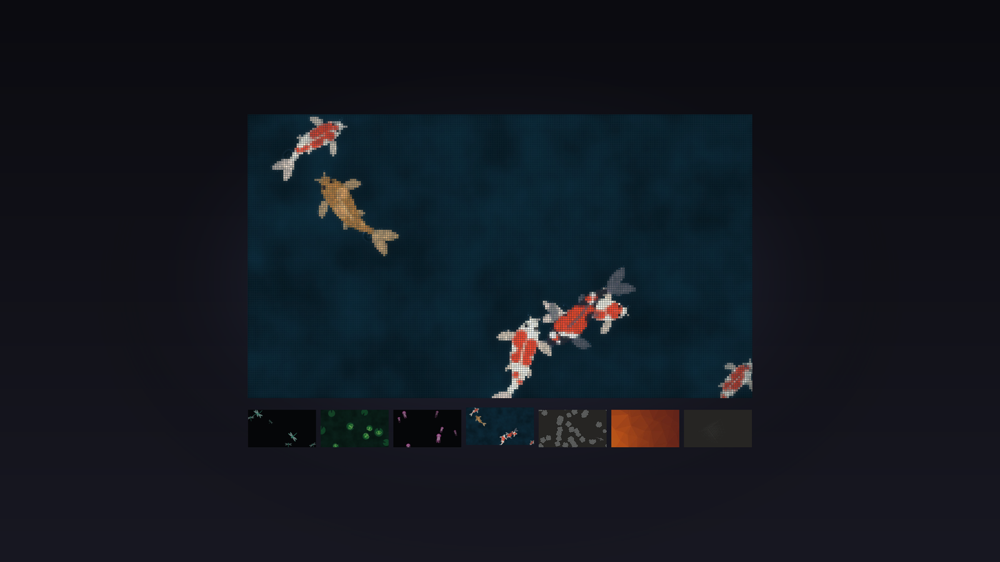

# Wallpaper Carousel

Прозрачная витрина обоев для Windows: по хоткею поверх рабочего стола появляется крупное
превью текущих обоев и лента миниатюр. Работает и с интерактивными обоями
[Lively Wallpaper](https://www.rocksdanister.com/lively/), и с обычными картинками.

Никакого фона, рамок, кнопок и анимаций — только изображения, всё остальное прозрачно.



## Возможности

- **Прозрачный оверлей.** Окно `-transparentcolor`: видно рабочий стол, поверх — превью и лента.
- **Мгновенное листание.** Никаких анимаций: кадр появляется сразу, перерисовываются две картинки.
- **Lively + картинки в одной ленте.** Интерактивные обои применяются через `Lively.exe setwp`,
  картинки — системно (`SystemParametersInfoW`).
- **Настройка мышью.** Правый клик по панели: смена хоткея, автозапуск, закрытие.
- **Свои хоткеи.** `Win+Alt+K`, `Ctrl+Shift+F9`, `Space` — что угодно, с проверкой занятости.
- **Работает без Lively.** Достаточно папки с картинками; она создаётся автоматически.
- **Память.** ~68 МБ в работе, ~9 МБ на старте; кэши LRU (источники 2, превью 4, миниатюры 120).

## Установка

### Вариант 1: готовый .exe (Python не нужен)

1. Скачай `WallpaperCarousel-1.0.0-win64.exe` из [релиза](../../releases).
2. Положи куда угодно и запусти — приложение уйдёт в трей рабочего стола (иконки нет, это
   нормально: панель вызывается хоткеем).
3. Нажми `Win+Alt+S`.

Чтобы запускать при запуске Windows: `WallpaperCarousel-1.0.0-win64.exe --install-autostart`
(или правый клик по панели → «Автозапуск: включить»).

### Вариант 2: из исходников

```sh
git clone https://github.com/Appappars/wallpaper-carousel
cd wallpaper-carousel
py -m pip install -r requirements.txt
py carousel.py --paths              # проверить, что нашлись Lively и картинки
py carousel.py --install-autostart  # по желанию
py carousel.py                      # запустить, далее Win+Alt+S
```

Нужен Windows 10/11, Python 3.8+ и `pillow`. Больше зависимостей нет: tkinter входит в Python.

## Управление

| Клавиша | Действие |
|---|---|
| `Win+Alt+S` | открыть / закрыть панель |
| `←` `→`, колесо | листать |
| `1`…`7` | прыгнуть к миниатюре в ленте |
| `Enter`, клик по превью | применить обои |
| клик по миниатюре | переключиться (по активной — применить) |
| `Esc`, клик мимо картинок | закрыть |
| `Win+Alt+Q` | выйти из приложения |

Активная миниатюра приподнята и не приглушена, остальные на 72 % яркости.

## Смена хоткея

Без терминала: **правый клик по панели → «Сменить хоткей…»**. В окне — чекбоксы
`Win / Alt / Ctrl / Shift` и список клавиш (A–Z, 0–9, F1–F12, Space). `Enter` сохраняет,
`Esc` отменяет. Комбинация проверяется на занятость; после сохранения приложение
перезапускается само. Если при старте хоткей оказался занят, это окно откроется автоматически.

Из терминала:

```sh
py carousel.py --hotkey win+alt+k    # сохранить и перезапустить
py carousel.py --show-hotkey         # что сейчас
py carousel.py --hotkey-dialog       # открыть окно настройки
```

## Если Lively не установлено

Lively не обязателен. Приложение использует папку `%USERPROFILE%\Pictures\Wallpapers`:
создаёт её при первом запуске, показывает всё, что в ней лежит (`.jpg .jpeg .png .bmp .webp`),
а имя файла становится названием обоев. Применение — системное, Lively не нужен.

Если не нашлось ничего, панель покажет окно с объяснением, что именно не найдено и куда
положить картинки.

## Откуда берутся обои

| Источник | Путь | Применение |
|---|---|---|
| Lively Wallpaper | `%LOCALAPPDATA%\Lively Wallpaper\Library\wallpapers\*` (папки с `LivelyInfo.json`) | `Lively.exe setwp --file <папка>` |
| Картинки | `%USERPROFILE%\Pictures\Wallpapers\*` | `SystemParametersInfoW` |

Пути определяются автоматически: `Lively.exe` ищется в `Program Files`, `Program Files (x86)`,
`%LOCALAPPDATA%\Programs` и в реестре. Если установка нестандартная — задай переменные
`LIVELY_EXE`, `LIVELY_LIB`, `PHOTO_DIR`.

Если Lively установлен, но ты выбираешь картинку, карусель гасит Lively: он рисуется поверх
рабочего стола и перекрыл бы обои.

## Команды

```
carousel.py                     запустить панель
carousel.py --show              запустить и сразу открыть панель
carousel.py --stop              остановить запущенный экземпляр
carousel.py --snapshot FILE     сохранить прозрачный кадр в PNG (--index N)
carousel.py --hotkey win+alt+k  задать хоткей и перезапустить
carousel.py --show-hotkey       показать текущий хоткей
carousel.py --hotkey-dialog     открыть окно смены хоткея
carousel.py --install-autostart добавить в автозагрузку
carousel.py --uninstall-autostart убрать из автозагрузки
carousel.py --paths             какие пути найдены, сколько обоев
carousel.py --help
```

## Файлы и настройки

Запуск из скрипта — файлы рядом со скриптом; запуск `.exe` — в `%LOCALAPPDATA%\WallpaperCarousel`
(если писать туда нельзя, приложение отступит к папке рядом с `.exe`, затем к `%TEMP%`).

| Файл | Что внутри |
|---|---|
| `hotkey.json` | модификаторы и клавиша |
| `state.json` | последние применённые обои |
| `carousel.log` | старт, регистрация хоткея, ошибки |
| `carousel.pid` | pid запущенного экземпляра |

`pythonw`/`.exe` не имеют консоли, поэтому всё пишется в `carousel.log`.

## Превью обоев

Headless-браузер не рисует WebGL-обои, поэтому `make_thumbs.py` открывает страницу в kiosk-окне
Chrome (или Edge), прячет CSS-обвес страницы и снимает кадр через несколько секунд.

```sh
python make_thumbs.py                 # только тем, у кого превью нет
python make_thumbs.py corals moire    # переснять конкретные
python make_thumbs.py --all
```

Старое превью сохраняется как `thumbnail.orig.png`. Браузер ищется автоматически,
переопределяется переменной `BROWSER_EXE`.

## Сборка .exe

```powershell
py -m pip install pyinstaller
py -m PyInstaller --noconfirm --clean --onefile --windowed `
  --name WallpaperCarousel-1.0.0-win64 --icon icon.ico `
  --distpath dist --workpath build --specpath build carousel.py
```

## Диагностика

- **Хоткей не срабатывает** — комбинацию заняла другая программа. Открой `--paths`/`carousel.log`
  или смени хоткей правым кликом по панели.
- **Панель не открывается** — проверь `carousel.log`: там записано, зарегистрирован ли хоткей.
- **Пусто в панели** — `py carousel.py --paths` покажет, какие пути найдены и сколько обоев.

## Лицензия

MIT — см. [LICENSE](LICENSE).
